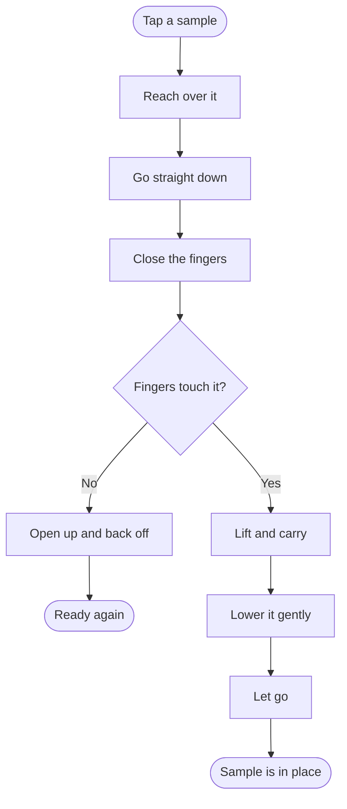
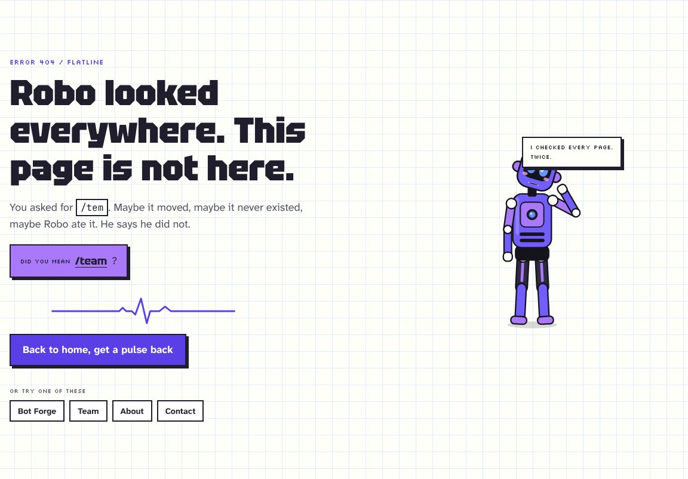

<div align="center">


# RO-BIO

### Where circuits meet cells.

Robots, sensors and the human body, built by students of **Biomedical and Robotic Engineering** at Mysore University School of Engineering, Mysuru.

_Unauthorised innovation in progress!_

<br />

<a href="https://ro-bio.robiohub2026.workers.dev"></a>
<a href="https://www.instagram.com/ro_bio_hub/"></a>
<a href="https://www.linkedin.com/in/ro-bio-hub-606b5840b/"></a>

<br /><br />

**[Visit the site](https://ro-bio.robiohub2026.workers.dev)** &nbsp;·&nbsp; **[Try the robot arm](#try-it-now)** &nbsp;·&nbsp; **[Play Robo Sumo](#try-it-now)** &nbsp;·&nbsp; **[Meet the team](https://ro-bio.robiohub2026.workers.dev/team)**

<br />


</div>

<br />

## Two kinds of machine, one loop

Our branch studies robots and bodies. A line-following robot and a hand holding a cup solve the same problem: **sense, decide, act, feed back.** So this website runs that same loop, and it is a little bit of both.

Everything here was built by students: the 3D robot arm, the Robo Sumo physics, the robot called Robo who walks across every page, and the ECG that beats in the header. It is open, so you can read every line.

<br />

## Try it now

<a id="try-it-now"></a>

| | Try this | What you will see |
| :-: | :-- | :-- |
| 🦾 | Tap a sample on the robot arm, then tap where it should go | The arm plans the whole move, grips, carries and sets it down gently |
| 🎮 | Push the CPU robot out of the Robo Sumo ring | Wheel grip, real physics, and a CPU that changes its tactics |
| 🤖 | Wait a moment on the home page | Robo wakes up, walks along the bottom of the screen and hops onto cards |
| 🦴 | Open Robo's menu and pick **X-ray** | His skeleton and heart show through, next to the biology inside |
| 💓 | Tap the heartbeat in the header | It speeds up while you play |
| 🔎 | Visit a page that does not exist, like `/tem` | Robo guesses you meant `/team` and the flatline comes back to life |

<br />

## The robot arm

This is the star of the home page. It is a five-joint collaborative arm with a two-finger gripper, drawn in 3D with [three.js](https://threejs.org).

Tap a sample, and the arm does the rest:



<details>
<summary><b>Two ways to drive it</b></summary>

<br />

- **Tap to move (default).** Tap a sample to pick it up, then tap a spot to put it down. With a mouse, the sample follows the cursor. You can also drag. The buttons under the arm send each sample straight to the tray.
- **Manual.** A control pad like a real robot's teach pendant. Hold the arrows to move across the bench, use Raise and Lower for height, and press one big **Grip** button to close the fingers. Press **Let go** to drop. Glass breaks if it falls from high up and lands on the bench, but survives the foam in the tray.

On a keyboard, the arrow keys move, W and S raise and lower, and Space grips.

</details>

<details>
<summary><b>Why the motion looks like a person's arm</b></summary>

<br />

- Every reach follows a **minimum-jerk curve**: the same smooth start and stop that human reaching follows. The shoulder leads and the wrist follows a moment later.
- Carrying speeds up gently and brakes into the spot, so nothing jerks.
- The elbow always stays above the bench, so the arm never flips over mid-move.
- It never sets one sample on top of another, and anything put near the tray lands inside it.
- The arm's maths lives in [`src/lib/arm-sim.ts`](src/lib/arm-sim.ts) and is covered by unit tests, so the motion stays correct as the site changes.

</details>

<br />

## Robo, the robot on every page

Robo is the mascot. He is a small robot with a skeleton inside, and he lives on every page of the site.

- He wakes up, walks along the bottom of the screen and hops onto headings and cards.
- You can pick him up and drop him.
- When you stop scrolling, he looks at the section you are reading and comments on it.
- Click a link and he uploads himself into the next page as a stream of pixels, then rebuilds there.
- Everything he says comes from the club facts in one file, so his lines never go out of date.

He respects reduced-motion settings and can be rested or hidden with one click, and that choice is remembered.

<br />

## Inside the site


**Robo Sumo** is a physics game against a CPU with tactics. The CPU flanks, brakes when it is pushed towards the edge, and reverses when it is stuck. A simulator plays seeded matches between the tactics and prints win rates: `node --experimental-strip-types scripts/sumo-sim.mjs`.

<br />


**The intro** runs once per visit. Robo is assembled part by part, X-rayed, and switched on in about six seconds. Skip it any time with a button or the Esc key. It is never shown to people who turn on reduced motion, and it ends by itself even if JavaScript fails.

<br />


**The team page** starts with the Head of Department and the faculty coordinator, then the President, Vice President and every squad. Each card flips to show more.

<br />


**Bot Forge** is the club's first event, a robotics competition with Robo Sumo and a Robot Race. The date is coming soon, and the page says so plainly until it is set.

<br />



**Pages that are not ready** say so honestly. Nothing on the site is made up.

<br />

## Built with

| Part | What it does |
| --- | --- |
| [TanStack Start](https://tanstack.com/start) and [React 19](https://react.dev) | Pages, routing and server rendering |
| [Tailwind CSS 4](https://tailwindcss.com) | Styling, colours and the blueprint look |
| [three.js](https://threejs.org) | The 3D robot arm, loaded after the page |
| Hand-written physics | Robo Sumo and the sample bench, with no physics engine |
| [Cloudflare Workers](https://workers.cloudflare.com) | Hosting, with a fresh deploy on every push to `main` |
| [Vitest](https://vitest.dev) | The unit tests |

Type is [Tektur](https://fonts.google.com/specimen/Tektur) for headings, [Atkinson Hyperlegible Next](https://fonts.google.com/specimen/Atkinson+Hyperlegible+Next) for reading (made for low-vision readers), Silkscreen for the pixel labels and JetBrains Mono for numbers.

<br />

## Keep the facts current

Club members do not need to touch the code to update the site. Every fact lives in one file, [`src/lib/site.ts`](src/lib/site.ts). Change it there, push, and the pages, the FAQ, the search-engine data and the AI-readable files all update by themselves.

| To change | Edit in `src/lib/site.ts` |
| --- | --- |
| Bot Forge date | `date` inside `events`, written `"YYYY-MM-DD"`. Use `null` for "Date coming soon" |
| Bot Forge activities | `activities` inside `events` |
| Head of Department and faculty | `faculty` |
| Coordinators and phone numbers | `contacts` |
| Core team | `coreTeam`. Each person is `m("Name", sem, "DEPT")` |
| Semester on the team cards | `currentSem` adds one to the announced semester. Update it when the semester changes |
| What we work on | `focusAreas` |
| Vision and mission | `vision` and `mission` |
| Venue map | `mapUrl` and `mapEmbed` |
| Live web address | `url`, once a custom domain is connected |

<br />

## Run it on your computer

You need [Node.js 22](https://nodejs.org) or newer.

```bash
npm ci
npm run dev
```

Then open http://localhost:5173 and start tapping.

| Command | What it does |
| --- | --- |
| `npm run dev` | The site with hot reload |
| `npm test` | Unit tests for the club facts, Robo, Robo Sumo, the arm and the ECG |
| `npm run build` | A production build, plus the sitemap, robots file and AI-readable files |
| `npm run preview` | The production build, running like it does on Cloudflare |
| `npm run deploy` | Builds and deploys by hand with Wrangler |

<br />

## Deploying

Every push to `main` builds and deploys by itself on Cloudflare Workers.

- Build command: `npm run build`
- Deploy command: `npx wrangler deploy`
- The Worker name in `wrangler.jsonc` (`ro-bio`) must match the project in Cloudflare.
- Keep `package-lock.json` in the repository, so Cloudflare installs the exact same versions every time.

<br />

## Privacy and security

- **No accounts, no forms, no analytics, no cookies, no tracking scripts.** The [Privacy Policy](https://ro-bio.robiohub2026.workers.dev/privacy) lists the few settings kept in your own browser.
- **Two outside services.** Fonts load from Google Fonts, and the venue map on the Contact and Bot Forge pages is a Google Maps embed. The Privacy Policy explains both.
- Every page is sent with a strict Content Security Policy and security headers ([`src/server.ts`](src/server.ts)). Clickjacking, MIME sniffing, and camera, microphone and location access are blocked.

<br />

## What is next

- Bot Forge date and registration, once the club confirms them
- Real photos for the gallery and team cards
- Write-ups of the projects members are building
- The full list is in [roadmap.md](roadmap.md)

<br />

<div align="center">


**RO-BIO** · Biomedical and Robotic Engineering · Mysore University School of Engineering

[Website](https://ro-bio.robiohub2026.workers.dev) · [Instagram @ro_bio_hub](https://www.instagram.com/ro_bio_hub/) · [LinkedIn](https://www.linkedin.com/in/ro-bio-hub-606b5840b/) · [Contact](https://ro-bio.robiohub2026.workers.dev/contact)

<sub>Built by students. The text, design, logo and artwork belong to RO-BIO and its creators.</sub>

</div>
