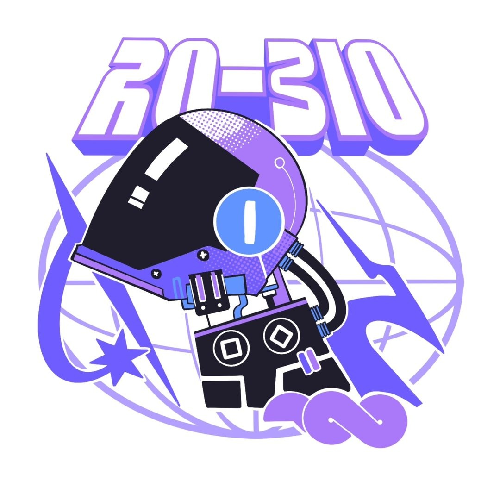
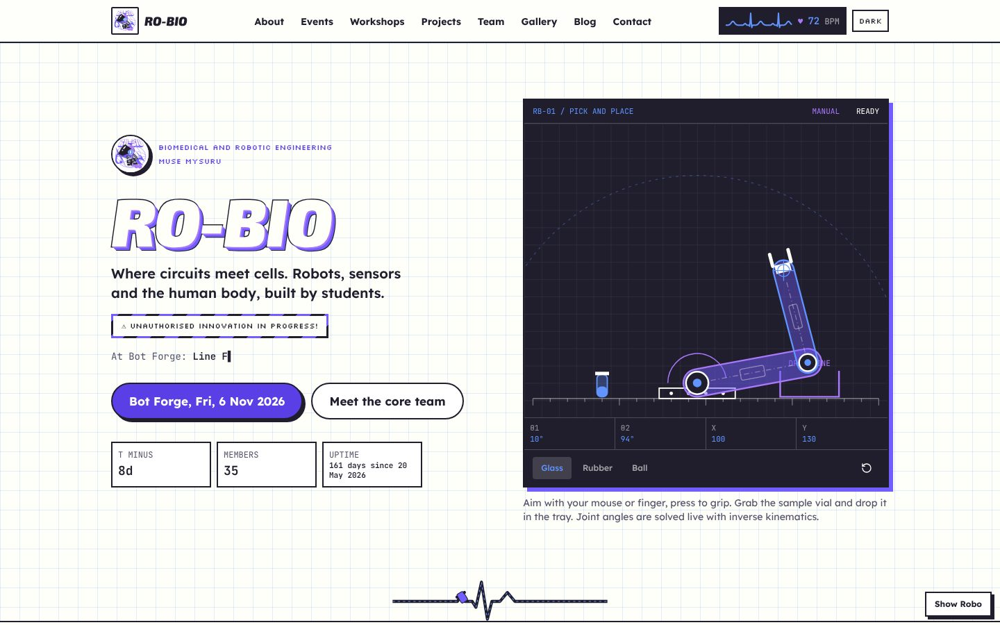
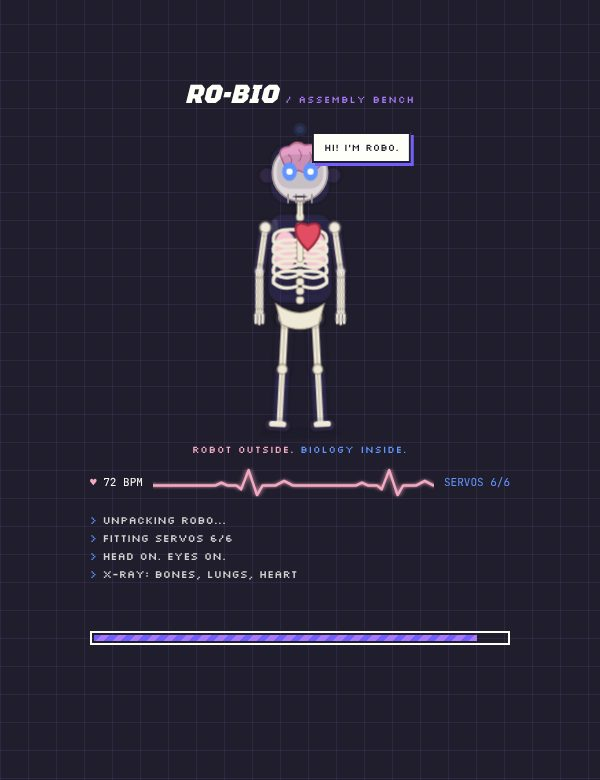
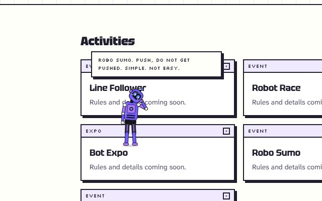
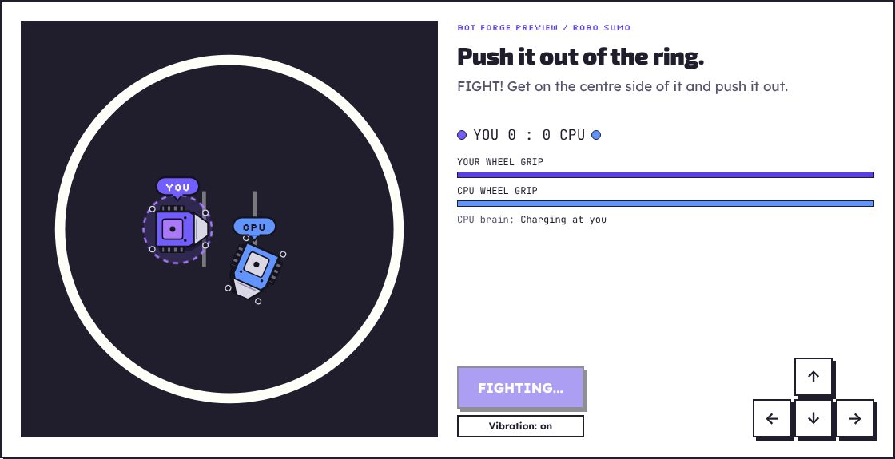
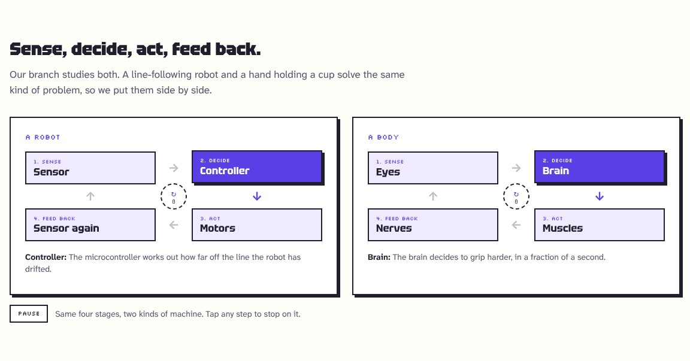
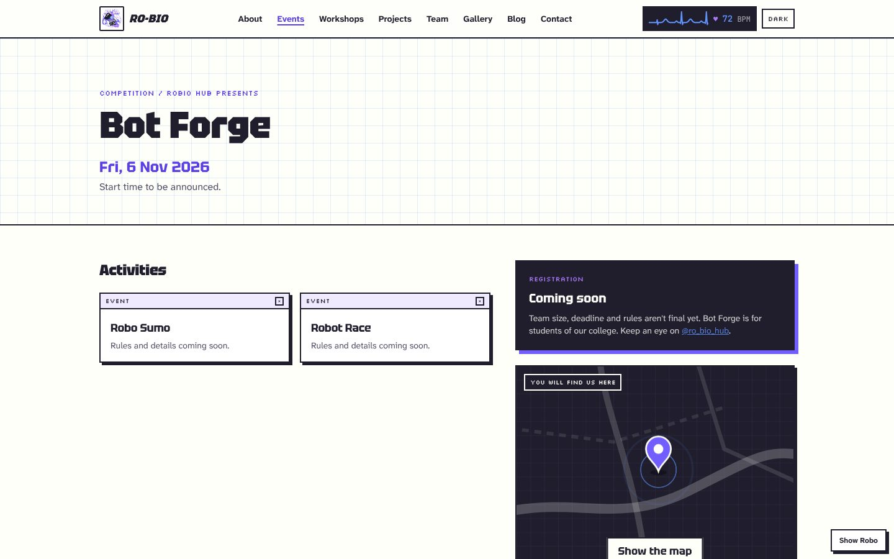
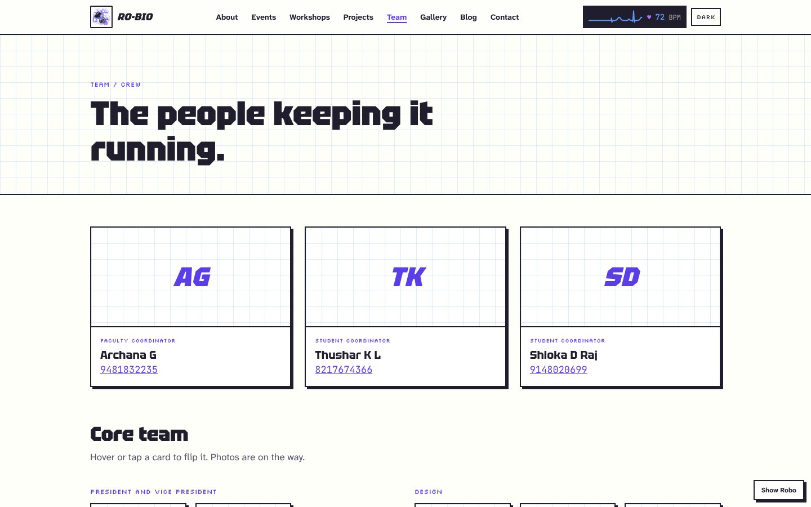
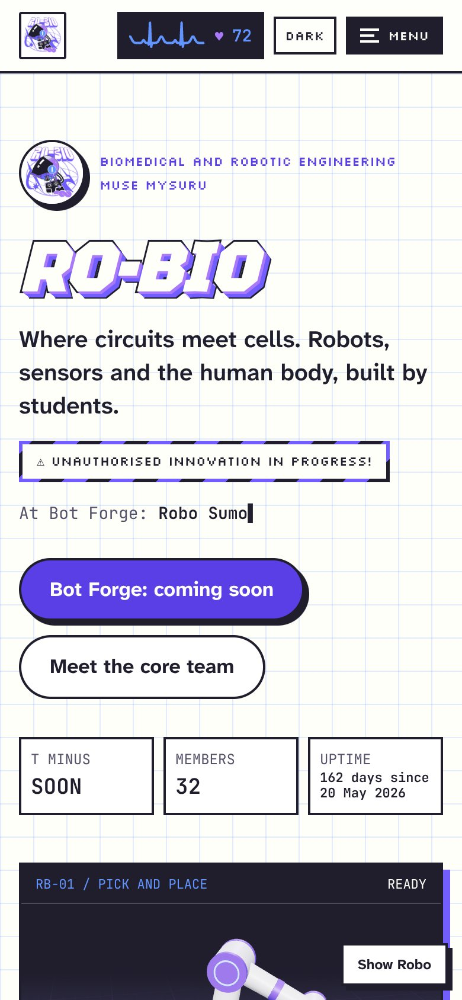
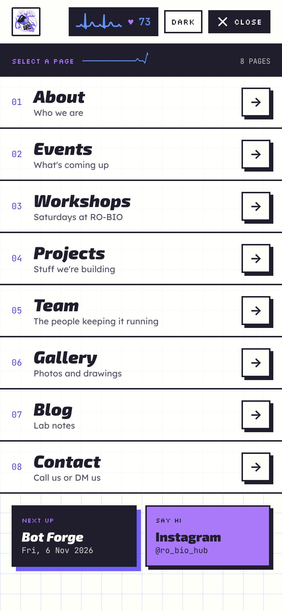

<div align="center">



# RO-BIO

**The student club of Biomedical and Robotic Engineering**<br />
Mysore University School of Engineering (MUSE), Manasa Gangotri Campus, Mysuru

_Unauthorised innovation in progress!_

<br />

<a href="https://ro-bio.robiohub2026.workers.dev"></a>
<a href="https://www.instagram.com/ro_bio_hub/"></a>


<br /><br />

<a href="https://ro-bio.robiohub2026.workers.dev">Visit the site</a> ·
<a href="https://ro-bio.robiohub2026.workers.dev/events/bot-forge">Bot Forge</a> ·
<a href="https://ro-bio.robiohub2026.workers.dev/team">Team</a> ·
<a href="https://ro-bio.robiohub2026.workers.dev/contact">Contact</a>

<br /><br />



</div>

<br />

## About the club

RO-BIO started on 20 May 2026 at Mysore University School of Engineering. It brings together students of Biomedical and Robotic Engineering, the branch that studies both kinds of machine: robots and the human body. Most Saturdays, engineers from companies like L&T come to campus to teach practical skills.

The club's first event is **Bot Forge**, with Line Follower, Robot Race, Bot Expo, Robo Sumo and Shark Tank. The date and registration news are on the [Bot Forge page](https://ro-bio.robiohub2026.workers.dev/events/bot-forge) and on Instagram.

<br />

## A look around

<div align="center">

<table>
  <tr>
    <td align="center" width="50%">
      <br />
      <sub><b>The intro.</b> Robo gets assembled, X-rayed and switched on. Tap him to speed up his heart.</sub>
    </td>
    <td align="center" width="50%">
      <br />
      <sub><b>Robo.</b> Roams every page, reads along and travels between pages as pixels.</sub>
    </td>
  </tr>
  <tr>
    <td align="center">
      <br />
      <sub><b>Robo Sumo.</b> Push the CPU robot out of the ring.</sub>
    </td>
    <td align="center">
      <br />
      <sub><b>Sense, decide, act, feed back.</b> A robot and a body, running the same loop.</sub>
    </td>
  </tr>
  <tr>
    <td align="center">
      <br />
      <sub><b>Bot Forge.</b> Date, activities, venue and coordinators.</sub>
    </td>
    <td align="center">
      <br />
      <sub><b>Team.</b> Coordinators and every squad of the core team.</sub>
    </td>
  </tr>
</table>

<br />


&nbsp;&nbsp;


<sub>On a phone: the home page and the mobile menu.</sub>

</div>

<br />

## What is on the site

| Page | What it has |
| --- | --- |
| [Home](https://ro-bio.robiohub2026.workers.dev/) | A robot arm that solves inverse kinematics live, a line follower, the Bot Forge countdown, Robo Sumo and the coordinators |
| [About](https://ro-bio.robiohub2026.workers.dev/about) | Who the club is, with a live feedback loop for a robot and a body |
| [Events](https://ro-bio.robiohub2026.workers.dev/events) and [Bot Forge](https://ro-bio.robiohub2026.workers.dev/events/bot-forge) | Dates (including the earlier ones), activities, venue and who to call |
| [Workshops](https://ro-bio.robiohub2026.workers.dev/workshops) | The Saturday sessions. Speaker list coming soon |
| [Projects](https://ro-bio.robiohub2026.workers.dev/projects) | What members are building. Write-ups coming soon |
| [Team](https://ro-bio.robiohub2026.workers.dev/team) | President, Vice President and every squad, with flip cards |
| [Gallery](https://ro-bio.robiohub2026.workers.dev/gallery) and [Blog](https://ro-bio.robiohub2026.workers.dev/blog) | Photos, art and write-ups. Coming soon |
| [Contact](https://ro-bio.robiohub2026.workers.dev/contact) | Phone numbers, address, map and Instagram |
| [FAQ](https://ro-bio.robiohub2026.workers.dev/faq), Privacy, Terms, Accessibility | Short and plain |

Pages that are waiting for the club's own content say so honestly. Nothing on the site is made up.

<br />

## The interactive parts

- **Robo** (`src/lib/robo-roam.ts`, `robo-rig.ts`, `robo-walk.ts`, `robo-talk.ts`, `components/site/RoboLayer.tsx`). A robot with a skeleton inside (try the X-ray from his menu). He wakes up, walks along the bottom of the screen, hops onto headings and cards, and can be picked up and dropped. When you stop scrolling he looks at the section you are reading, tilts his head at it and says something about it. Click a link and he uploads himself into it as a stream of pixels (`robo-pixels.ts`), then gets rebuilt pixel by pixel on the next page. Everything he says comes from the club facts, so it never goes out of date.
- **Robot arm** (`components/site/RobotArm.tsx`). Two-joint inverse kinematics with real physics. Pick up the sample vial and drop it in the tray.
- **Robo Sumo** (`src/lib/sumo.ts`, `components/site/SumoGame.tsx`). Physics, wheel grip and a CPU with tactics. `node --experimental-strip-types scripts/sumo-sim.mjs` plays hundreds of seeded matches and prints win rates.
- **Live heartbeat** (`components/site/HeaderEcg.tsx`). The ECG in the header speeds up when you are active.
- **Feedback loop** (`components/site/FeedbackLoop.tsx`). Sense, decide, act, feed back, for a robot and a body at the same time.
- **Intro** (`components/site/BootScreen.tsx`). On the first visit, Robo is assembled part by part, X-rayed (robot outside, biology inside) and switched on, in about 6 seconds. Tap him and his heart races, and the intro waits while you play. Skip it any time, or press Esc. It is never shown to people who turn on reduced motion, and its timing is pure CSS, so it ends by itself even if JavaScript fails.

Everything respects `prefers-reduced-motion`, works with a keyboard, and has a light and a dark theme.

**Type:** [Tektur](https://fonts.google.com/specimen/Tektur) for headings (angular, like machined parts), [Atkinson Hyperlegible Next](https://fonts.google.com/specimen/Atkinson+Hyperlegible+Next) for text (drawn by the Braille Institute for low vision readers), Silkscreen for the pixel labels and JetBrains Mono for numbers. All free from Google Fonts.

<br />

## Updating club facts (no coding needed)

All the facts live in one file: **`src/lib/site.ts`**. Change them there and every page, the FAQ, the structured data for Google and the files for AI assistants update by themselves.

| To change | Edit this in `src/lib/site.ts` |
| --- | --- |
| Event date | `date` inside `events` (written `YYYY-MM-DD`). Move the old date into `previousDates` |
| Registration | `registration: "coming-soon"` (or `"open"` / `"closed"`) |
| Coordinators and phone numbers | `contacts` |
| Core team | `coreTeam`. Each person is `m("Name", sem, "DEPT")`. `sem` is the semester at the time of the announcement |
| Member count | `memberCount` |
| Live web address | `url` (change it when a custom domain is connected) |

After you push, Cloudflare rebuilds and deploys the site in a minute or two.

<br />

## Run it on your computer

You need [Node.js 22](https://nodejs.org/) or newer.

```sh
npm ci
npm run dev
```

Then open http://localhost:5173.

| Command | What it does |
| --- | --- |
| `npm run dev` | Local site with hot reload |
| `npm test` | Unit tests (club facts, FAQ, team, Robo's walk and talk, sumo physics, ECG) |
| `npm run build` | Production build. Also regenerates `sitemap.xml`, `robots.txt`, `llms.txt` and `llms-full.txt` |
| `npm run preview` | Runs the production build locally on the Cloudflare Workers runtime |
| `npm run deploy` | Builds and deploys by hand with Wrangler |

<br />

## Deploying

The repository is connected to Cloudflare Workers. Every push to `main` builds and deploys automatically.

- Build command: `npm run build`
- Deploy command: `npx wrangler deploy`
- The Worker name in `wrangler.jsonc` (`ro-bio`) must match the project name in Cloudflare.
- Keep `package-lock.json` in the repository. With it, Cloudflare runs `npm ci`, which installs the exact same versions every time and avoids a dependency resolution bug in npm 10.

<br />

## Security and privacy

- No accounts, no forms, no analytics, no cookies, and no third-party scripts. The [Privacy Policy](https://ro-bio.robiohub2026.workers.dev/privacy) lists the few settings kept in your own browser.
- Every page is sent with a strict Content Security Policy and security headers (`src/server.ts`). Static files get the same headers from `public/_headers`. Clickjacking, MIME sniffing and camera, microphone and location access are all blocked.
- External links open with `rel="noreferrer"`, and structured data is escaped before it goes into the page.

<br />

## SEO and AI readiness

Every page has its own title, description, canonical link and share image, so links look right on WhatsApp, Instagram and Google. Pages carry structured data (Organization, WebSite, Event, FAQPage). `llms.txt` and `llms-full.txt` give AI assistants the facts straight from the club.

<br />

## Project structure

```text
src/
  routes/            one file per page (file-based routing, see src/routes/README.md)
  components/site/   the site's own components: header, footer, Robo, arm, sumo, loop, intro
  components/ui/     shared UI building blocks
  lib/site.ts        all club facts, edit here
  lib/robo-*.ts      Robo's body, walk, brain, lines and pixel teleport
  lib/sumo.ts        Robo Sumo physics and CPU
  server.ts          Cloudflare Worker entry and security headers
  styles.css         colours, fonts and animations
public/              favicon, share image, robots.txt, sitemap.xml, llms.txt, _headers
scripts/             SEO file generator, Robo preview renders, sumo simulator, Robo browser checks
docs/screenshots/    the images in this README
```

<br />

<div align="center">


**RO-BIO** · Biomedical and Robotic Engineering · Mysore University School of Engineering

[Website](https://ro-bio.robiohub2026.workers.dev) · [Instagram @ro_bio_hub](https://www.instagram.com/ro_bio_hub/) · [Contact](https://ro-bio.robiohub2026.workers.dev/contact)

<sub>Built by students. The text, design, logo and artwork belong to RO-BIO and its creators.</sub>

</div>
